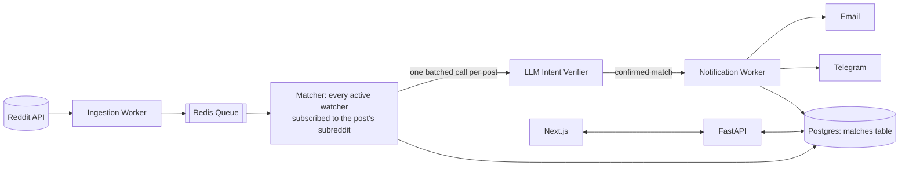

# Architecture

Companion to [[PRD]] and [[FEATURES]]. Covers system design, tech stack, data model, deployment,
and monitoring for Phase 1 (MVP), with notes on what changes in later phases.

## 1. High-level pipeline



Each stage is a separate worker process so it can be scaled independently in Docker (ingestion is
rate-limited by Reddit; the matcher/verifier stage is cost-sensitive; notification is bursty).

## 2. Why this shape (recap of key decisions)

- **Watchers are scoped to specific subreddits** (not all of Reddit) — bounds ingestion volume,
  keeps LLM cost predictable, matches Reddit API rate limits. See [[PRD]] §8.
- **Single-stage LLM matching** exists specifically to solve the "offers vs. needs" false-positive
  problem described in [[PRD]] §1. An earlier vector-similarity gate was tried and dropped:
  embedding similarity alone could not distinguish intent direction reliably, and a bolted-on
  "direction axis" correction was needed to compensate. Sending every subscribed watcher straight
  to the LLM — batched one call per post — removes that failure mode instead of correcting for it,
  at the cost of no longer having a cheap pre-filter stage; see [[matcher]] for the full reasoning.
- **Same matching speed for free and paid** (per PRD tier decision) — the ingestion/matching
  pipeline runs once, uniformly; tier logic only gates watcher count, subreddit count, and
  notification channels at the API layer.

## 3. Components

### Ingestion Worker
- Uses `asyncpraw` (async Reddit API client) with OAuth "script" app credentials
- Polls the distinct set of subreddits across all *active* watchers (union, not per-watcher — one
  post insert can match multiple watchers)
- Poll interval and Reddit's ~100 QPM-class rate limit are the primary scaling constraint on total
  subreddit coverage — tracked as a scaling question in [[PROGRESS]]
- Dedupes by Reddit post ID before pushing to the queue
- Emits a heartbeat on every successful poll cycle (used by uptime monitoring, see §7)

### Matcher + LLM Verifier
- Consumes new posts from the queue
- Finds every *active watcher whose subreddit list includes this post's subreddit* — a plain SQL
  filter, no similarity search or embedding involved
- Sends the post plus every candidate watcher's intent to an LLM (`gpt-4o-mini`) in a single
  batched call per post (chunked only if a subreddit has more candidates than the configured
  batch size), and gets back one yes/no verdict per watcher, judged on direction, subject, and
  substance together
- Every candidate is written to the `matches` table, pass or fail — rejected rows are a
  calibration record of what the verifier saw and decided, not discarded
- Confirmed matches are enqueued for notification
- See [[matcher]] for why one batched call per post replaced the earlier vector-gate design

### Notification Worker
- Reads a confirmed match + the watcher's configured channels
- Sends email (via a transactional email provider) and/or Telegram (via bot API, using the
  chat ID the user linked at setup)
- Records delivery status against the match row

### FastAPI backend (`/backend`)
- User-facing REST API: auth, watcher CRUD, match feed/history, notification channel settings,
  billing webhook handling (Stripe)
- Enforces plan limits (watcher count, subreddits per watcher, channels) server-side
- Does **not** run the ingestion/matching pipeline in-process — that's the worker fleet, kept
  separate so the user-facing API stays responsive regardless of pipeline load

### Next.js frontend (`/frontend`)
- Auth screens, watcher management UI, match dashboard/inbox, notification settings, billing
  upgrade flow

## 4. Data model (MVP sketch)

```
users            (id, email, auth info, plan, created_at)
watchers         (id, user_id, name, intent_text, subreddits[], status, created_at)
reddit_posts     (id, reddit_post_id, subreddit, title, body, author, fetched_at)
matches          (id, watcher_id, reddit_post_id, llm_verified bool, llm_reason, created_at, read_at)
notifications    (id, match_id, channel, status, sent_at)
notification_channels (id, user_id, type[email|telegram], config, verified bool)
subscriptions    (id, user_id, stripe_customer_id, plan, status)
```

Exact columns will firm up once the backend scaffolding starts; this is enough to drive API and
worker design.

## 5. Tech stack

| Layer | Choice | Notes |
|---|---|---|
| Backend API | FastAPI | `/backend` |
| Frontend | Next.js (App Router) | `/frontend` |
| Auth | Clerk | |
| Reddit client | asyncpraw | OAuth script app |
| Primary DB | Postgres | Single datastore for MVP |
| Queue / broker | Redis + Arq | Async-native, lightweight vs. Celery |
| Intent verification | OpenAI `gpt-4o-mini` | One batched call per post, covering every candidate watcher — see [[matcher]] |
| Email | Resend | |
| Telegram | Bot API | |
| Billing | Stripe | |
| Error tracking | Sentry | FastAPI + Next.js SDKs |
| Metrics | Prometheus + Grafana | |
| Logs | structlog → Loki (or ELK) | |
| Containerization | Docker + docker-compose (dev/small prod) | K8s only if/when needed, see §6 |

## 6. Deployment

- **Local/dev**: `docker-compose.yml` with services: `api`, `worker-ingest`, `worker-match`,
  `worker-notify`, `postgres`, `redis`, `frontend`
- **Production (MVP scale)**: same compose topology on a single host or a managed container
  platform (Fly.io / Railway / a small ECS setup) — avoid Kubernetes until there's a concrete
  need for multi-node horizontal scaling of the worker fleet
- Workers are stateless and horizontally scalable independently (e.g. more `worker-match`
  replicas if verification becomes the bottleneck, without touching ingestion)
- Config/secrets via environment variables, `.env` for local dev (never committed)

## 7. Monitoring & observability

Motivated by the specific failure mode where a silent ingestion outage means a user gets zero
notifications and may not notice for days:

- **Sentry**: error tracking across FastAPI and Next.js
- **Prometheus + Grafana**: ingestion rate per subreddit, queue depth per stage, match rate,
  notification delivery latency, LLM/embedding API spend
- **Heartbeat/dead-man's-switch** (healthchecks.io or similar): ingestion worker pings on every
  successful poll cycle; missed pings alert immediately
- **Structured logs** (structlog) shipped to Loki/ELK, correlated by request/job ID across the
  pipeline stages
- **Cost tracking**: per-call logging of LLM spend, since cost scales with ingestion volume
  (Reddit traffic) — specifically with posts × watchers-per-subreddit — not directly with
  paying-user count. Called out as a risk in [[PRD]]

## 8. Security & compliance notes

- Reddit API usage must stay within official OAuth terms — no scraping fallback
- Store only what's needed from Reddit posts (avoid unnecessary retention of user-identifying
  Reddit data beyond what's needed to show/link the match)
- Stripe handles payment data directly (no card data touches our backend)
- Standard secrets hygiene: API keys/tokens in environment/secret manager, never in the repo

## 9. Open technical decisions

Tracked in [[PROGRESS]] — auth provider choice, exact free/paid numeric limits, email provider
choice, initial similarity threshold value.
