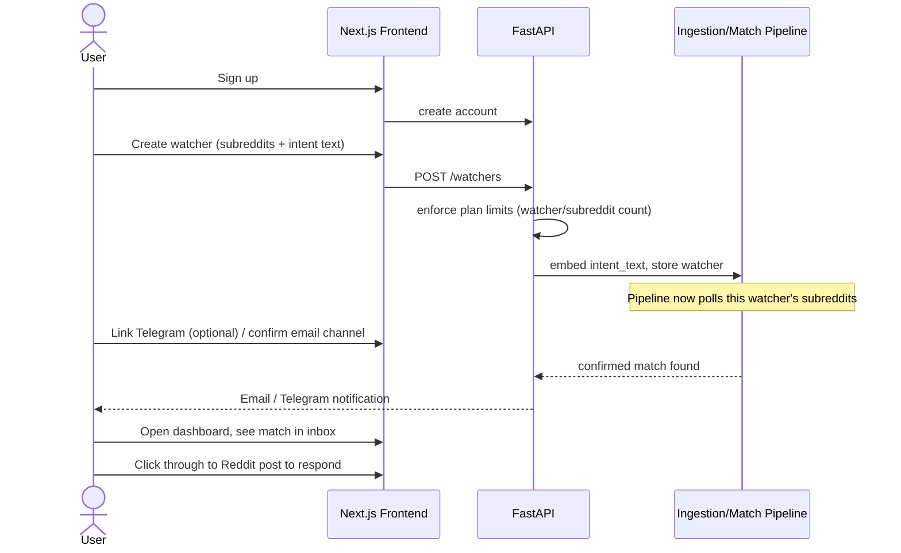
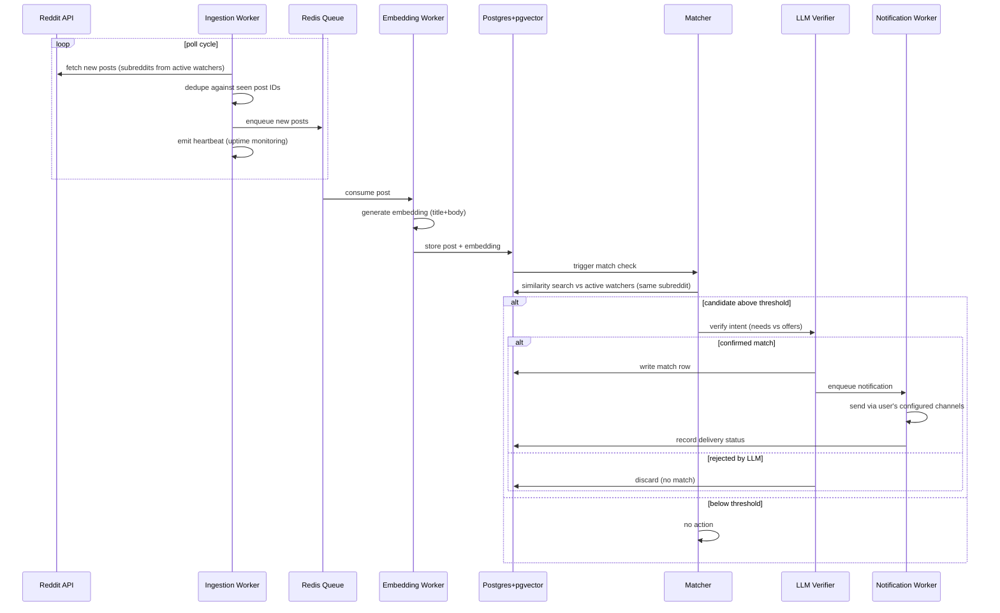

# Workflows

Companion to [[ARCHITECTURE]]. Two workflows: what the user experiences, and what the system does
in the background to make it happen.

## 1. User-facing workflow: onboarding to first match

Notes:
- Notification channel setup can happen before or after the first watcher is created; email
  defaults to the account email, Telegram requires an explicit link step (bot deep link).
- Free-tier users are capped at watcher/subreddit creation time — the UI should surface the limit
  before the API rejects the request, not just show a generic error.

## 2. System workflow: post ingestion to notification

