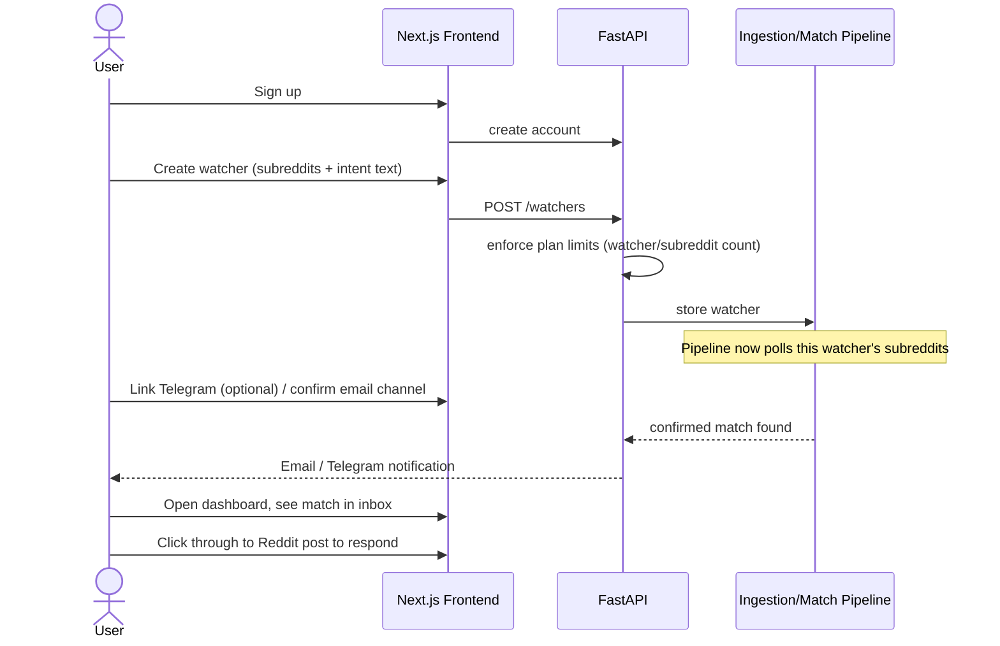
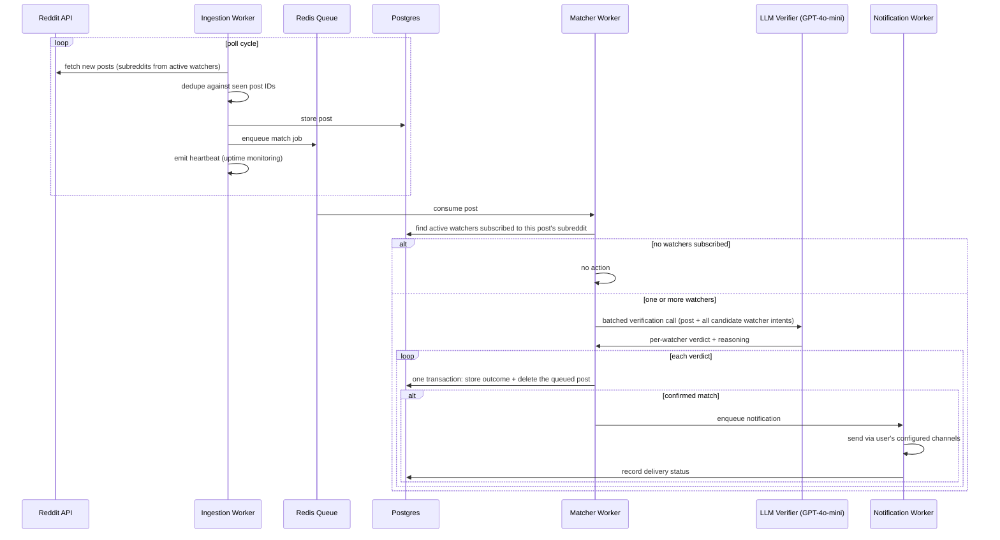

# Workflows

Companion to [[ARCHITECTURE]]. Two workflows: what the user experiences, and what the system does
in the background to make it happen.

## 1. User-facing workflow: onboarding to first match

Notes:
- Notification channel setup can happen before or after the first watcher is created; email
  defaults to the account email, Telegram requires an explicit link step (bot deep link).
- Free-tier users are capped at watcher/subreddit creation time — the UI should surface the limit
  before the API rejects the request, not just show a generic error.

## 2. System workflow: post ingestion to notification

Notes:
- One LLM call per post, not one per (post, watcher) pair — the call is batched across every
  active watcher subscribed to that post's subreddit, and returns a verdict per watcher.
- Only confirmed verdicts become `matches` rows (with the post copied to `matched_posts`).
  Rejected candidates are counted in `match_stats` and sampled into a 7-day `rejection_log`; the
  queued post is deleted either way, so `reddit_posts` only ever holds posts awaiting the LLM.
- A new watcher judges posts made at or after its creation; a one-off catch-up job judges the
  previous hour (fetched straight from Reddit) against that watcher alone.
- Large subreddits (many subscribed watchers) split into multiple batched calls rather than one
  unbounded call.
