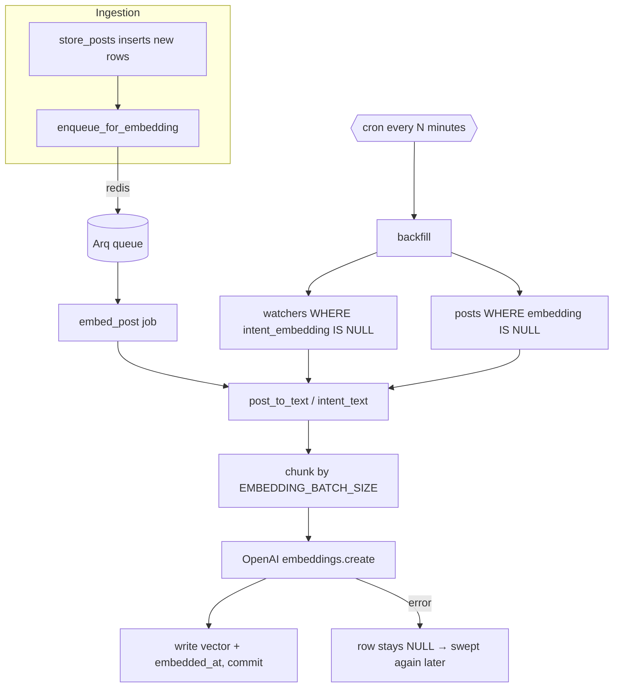

# Embedding Worker

Code-level walkthrough of the second pipeline stage. Companion to [[ARCHITECTURE]] §3 (design intent)
and [[PROGRESS]] (what is built vs. pending). This document describes what the code *currently does*
— where it diverges from the architecture doc, that is called out explicitly.

**What it does, in one sentence**: take the posts the ingestion worker stored and the intent
descriptions users wrote, and turn both into vectors so the matcher can compare them numerically.

It does not compare anything, score anything, or notify anyone — the matcher doesn't exist yet. It
runs as an Arq consumer (`arq app.workers.embed.WorkerSettings`), and in docker-compose it is the
`worker-embed` service.

## 1. Files involved

| File | Purpose |
|---|---|
| [`backend/app/workers/embed.py`](../../backend/app/workers/embed.py) | The worker — the two Arq jobs, the backfill sweep, and the Arq configuration. |
| [`backend/app/workers/embedding_source.py`](../../backend/app/workers/embedding_source.py) | Everything that talks to OpenAI, plus the text-preparation and cost-logging helpers. |
| [`backend/app/core/constants.py`](../../backend/app/core/constants.py) | `EMBEDDING_DIMENSIONS`. Lives in `core` so `app.models` never imports from `app.workers`. |
| [`backend/app/core/config.py`](../../backend/app/core/config.py) | Settings: API key, model, batch size, sweep interval and limit. |
| [`backend/app/models/reddit_post.py`](../../backend/app/models/reddit_post.py) | Gained `embedding` and `embedded_at`. The worker's **input and output**. |
| [`backend/app/models/watcher.py`](../../backend/app/models/watcher.py) | Gained `intent_embedding` and `embedded_at`. Also input and output. |
| [`backend/app/workers/ingest.py`](../../backend/app/workers/ingest.py) | Now enqueues an `embed_post` job for every newly inserted post. |
| [`backend/alembic/versions/b7e1f3c9d024_add_embedding_columns.py`](../../backend/alembic/versions/b7e1f3c9d024_add_embedding_columns.py) | Adds the four columns and three indexes. |
| [`docker-compose.yml`](../../docker-compose.yml) | Runs the worker as the `worker-embed` container. |
| [`backend/tests/test_embed.py`](../../backend/tests/test_embed.py) | Tests the worker logic against a fake provider. |
| [`backend/tests/test_embedding_source.py`](../../backend/tests/test_embedding_source.py) | Tests text preparation, the factory's validation, and response handling. |
| [`backend/tests/conftest.py`](../../backend/tests/conftest.py) | Holds `FakeEmbeddingProvider` — test-only, see §6. |

## 2. Flow at a glance



## 3. Why two triggers

A queue alone is not enough, for three concrete reasons:

1. **Posts predating the worker.** 25 posts were already sitting in `reddit_posts` from the ingestion
   worker's verification run. Nothing enqueued them, so a queue-only design would ignore them forever.
2. **Jobs that exhaust their retries.** `max_tries = 3`; after that Arq gives up and the job is gone.
   Without a sweep, that post is silently never embedded — and a missing embedding means the matcher
   cannot ever match it, which is an invisible failure.
3. **Watchers have no CRUD API yet.** Nothing exists to enqueue `embed_watcher` from, so today the
   sweep is the *only* thing that embeds watcher intents.

The queue gives low latency for the common case; the sweep guarantees eventual completion. Together
they make the stage self-healing: the recovery path for almost any failure is "leave the column NULL
and let the sweep find it."

## 4. Step by step

### 4.1 Startup — `startup()` (`embed.py:184-197`)

Arq calls this once per worker process. It configures logging, stores `Settings` in the job context,
and builds the embedding provider once — so every job reuses one HTTP connection pool instead of
opening its own.

`build_embedding_provider` raises immediately if `OPENAI_API_KEY` is empty, with a message naming the
file to put it in. There is no offline mode: a worker that silently embedded nothing would look
healthy while the pipeline starved.

### 4.2 Preparing text — `post_to_text()` (`embedding_source.py:36-38`)

```python
f"{title}\n\n{body}" if body.strip() else title
```

Title leads because it carries most of the intent signal. An empty body — which is *every* post in
RSS mode — yields title only, with no trailing separator. The result is truncated to
`MAX_INPUT_CHARS` (8000 tokens × 4 chars/token). That budget is a deliberate approximation: the cap
only needs to be safely under the model's 8191-token limit, which isn't worth a tokenizer dependency.

### 4.3 Calling the API — `OpenAIEmbeddingProvider.embed()` (`embedding_source.py:47-67`)

One API call per batch, not per row — cost and latency both scale with request count.

Two guards worth knowing about:

- **Results are re-sorted by `index`.** The API documents order preservation, but the callers pair
  vectors with rows *positionally*. If that ever broke, every post would silently get another post's
  vector, and matching would be quietly wrong rather than visibly broken. Sorting is cheap insurance.
- **Vector width is checked against `EMBEDDING_DIMENSIONS`.** A model swap that changes width would
  otherwise fail deep inside the database driver with an opaque error.

`_log_usage` then logs tokens and estimated USD per call, which is what [[ARCHITECTURE]] §7 asks for
under cost tracking. This is the first stage that spends money per post, so the meter starts here.

### 4.4 Writing vectors — `embed_posts()` / `embed_watchers()` (`embed.py:46-95`)

Both follow the same shape:

1. Build `(row, text)` pairs.
2. Drop rows whose text is empty, logging a warning. They are never sent to the API, which rejects
   empty input. Such rows stay NULL and get retried on later sweeps — harmless, since a Reddit post
   with no title is effectively impossible.
3. Chunk by `EMBEDDING_BATCH_SIZE`, embed each chunk, assign `embedding` and `embedded_at`.
4. Commit **once**, and only if something was updated.

`zip(..., strict=True)` is deliberate: a length mismatch between inputs and returned vectors raises
instead of silently pairing the wrong ones.

The commit placement is what makes failure safe. If the API raises mid-batch, the exception
propagates before any commit, so no row is left half-written and every affected row is still NULL —
exactly the state the sweep looks for.

### 4.5 The single-row jobs — `embed_post()` / `embed_watcher()` (`embed.py:123-150`)

Both load the row, skip if it is already embedded (making a duplicate delivery a cheap no-op), and
delegate to the batch function with a batch of one.

`embed_post` returns 0 with a warning if the row has vanished. `embed_watcher` takes a `force` flag
for the case that matters once watcher editing exists: when a user rewrites `intent_text`, the stored
vector describes the *old* wording, so it must be re-embedded even though it is non-NULL.

### 4.6 The sweep — `backfill()` (`embed.py:155-170`)

Runs watchers first, then posts. Watchers come first on purpose: a post embedded with no watcher
vectors to compare against is useless work, whereas a watcher vector is immediately useful to every
post that follows.

Both queries filter on `IS NULL`, ordered oldest-first so a backlog drains in arrival order, capped
at `EMBED_BACKFILL_LIMIT` (500) so one sweep cannot balloon into an unbounded spend. Watcher
selection also filters `status == "active"` — the matcher ignores paused watchers, so embedding them
would be spend with no payoff.

When there is nothing pending, the sweep logs nothing and returns 0. Both queries hit partial indexes
(§5), so an idle sweep is an index scan, not a table scan.

### 4.7 Scheduling — `backfill_minutes()` (`embed.py:175-179`)

Arq's `cron` takes a *set of minutes*, not an interval. This converts `EMBED_BACKFILL_INTERVAL_MINUTES`
into `{0, 5, 10, ...}`, walking the value down to the nearest divisor of 60 if it isn't one — so
`7` becomes `6` rather than producing an uneven schedule that fires twice in a row at the hour
boundary. `run_at_startup=True` means a restart sweeps immediately instead of waiting.

### 4.8 The ingestion hook — `enqueue_for_embedding()` (`ingest.py:51-63`)

`store_posts` already used `.returning(RedditPost.id)`, so the ids of genuinely new rows were
available; it now returns that list instead of just its length.

For each id, one job is enqueued with `_job_id=f"embed_post:{post_id}"`. Deriving the job id from the
post id makes a duplicate enqueue a no-op inside Arq.

Two deliberate non-fatal paths:

- **Redis unreachable at startup** — logged, `redis` stays `None`, ingestion continues.
- **An individual enqueue raising** — logged per post, loop continues.

Ingestion must never stop because the next stage is unavailable. The sweep is what makes that safe.

## 5. Schema changes

Migration `b7e1f3c9d024` adds:

| Column | Table | Notes |
|---|---|---|
| `embedding` | `reddit_posts` | `VECTOR(1536)`, nullable |
| `embedded_at` | `reddit_posts` | timestamptz, nullable |
| `intent_embedding` | `watchers` | `VECTOR(1536)`, nullable |
| `embedded_at` | `watchers` | timestamptz, nullable |

**Nullable is load-bearing.** NULL *is* the "not embedded yet" marker the sweep queries. Giving these
columns a default would break the mechanism.

Three indexes:

- `ix_reddit_posts_pending_embedding` and `ix_watchers_pending_embedding` — partial indexes
  `WHERE embedding IS NULL`, covering the sweep's hot query. They shrink as rows get embedded, so
  they stay small even as the tables grow.
- `ix_watchers_intent_embedding_hnsw` — HNSW, `vector_cosine_ops`, on the **watcher** side only.

The one-sided vector index deserves an explanation. The matcher searches *watchers* for each incoming
post, so that is the read path worth indexing. `reddit_posts` takes constant inserts and nothing
queries it by vector yet, so indexing it would be a write-throughput cost for no current benefit —
easy to add when a query needs it.

`EMBEDDING_DIMENSIONS` (1536) is a constant, not a setting, because it is baked into the column type.
Changing it means a migration plus re-embedding every row. Exposing it as config would imply it is
safe to change at runtime, which it is not.

## 6. Testing

`FakeEmbeddingProvider` lives in [`tests/conftest.py`](../../backend/tests/conftest.py), not in
`app/`. It satisfies the `EmbeddingProvider` protocol and produces deterministic hash-derived
vectors — no key, no network, no spend. That is the only reason the protocol exists with a single
real implementation: it lets tests exercise the actual `embed.py` code paths rather than mocking
them out.

It was deliberately **not** made a config-selectable runtime provider. Fake vectors carry no semantic
meaning, so a keyless pipeline would prove the plumbing moves data and prove nothing about whether
matching works — while adding a code path that could reach production by misconfiguration.

Coverage: batching boundaries, empty-text skipping, title+body joining, provider failure leaving rows
NULL, the sweep's selection and no-op case, cron minute derivation, out-of-order API responses,
dimension mismatch, and the ingestion enqueue path including a failing queue.

## 7. Configuration

| Setting | Default | Effect |
|---|---|---|
| `OPENAI_API_KEY` | empty | **Required.** The worker refuses to start without it. |
| `EMBEDDING_MODEL` | `text-embedding-3-small` | Must emit 1536 dimensions or `embed()` raises. |
| `EMBEDDING_BATCH_SIZE` | `100` | Texts per API call. |
| `EMBED_BACKFILL_INTERVAL_MINUTES` | `5` | Sweep frequency. Should divide 60 evenly. |
| `EMBED_BACKFILL_LIMIT` | `500` | Max rows per sweep, per table. Bounds worst-case spend per pass. |
| `REDIS_URL` | `redis://localhost:6379/0` | Queue connection, both sides. |
| `DATABASE_URL` | local Postgres | Used by `async_session_factory`. |

## 8. Known gaps vs. the architecture doc

- **RSS mode embeds titles only.** In `rss` mode `body` is always empty, so vectors are built from
  titles alone. Fine for proving the plumbing; **not** representative of production. Do not calibrate
  the matcher's similarity gate on RSS-derived scores — that open decision in [[PROGRESS]] should stay
  open until there is `api`-mode data with real bodies.
- **No heartbeat.** [[ARCHITECTURE]] §7 wants one per successful cycle for uptime monitoring. There
  are only log lines, same gap as the ingestion worker.
- **No re-embed trigger on watcher edit.** `embed_watcher(force=True)` exists for it, but nothing
  calls it — that wiring belongs to the watcher CRUD milestone.
- **No dead-letter handling.** After `max_tries`, a job is dropped and recovery depends entirely on
  the sweep. Acceptable while the sweep runs every 5 minutes; revisit if the queue gets deeper.
- **Cost logging is per-call, not aggregated.** Log lines carry token counts and an estimated cost,
  but nothing sums them. Real spend tracking needs the metrics stack ([[ARCHITECTURE]] §7).
