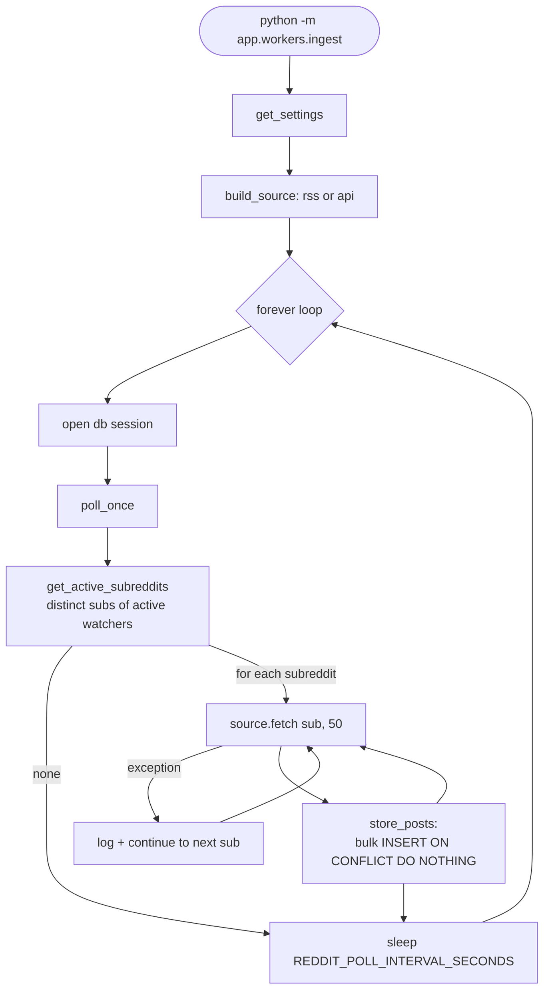

# Ingestion Worker

Code-level walkthrough of the first pipeline stage. Companion to [[ARCHITECTURE]] §3 (design intent)
and [[PROGRESS]] (what is built vs. pending). This document describes what the code *currently does*
— where it diverges from the architecture doc, that is called out explicitly.

**What it does, in one sentence**: look at which subreddits people are actively watching, pull the
newest posts from each, and store any post not already stored.

It does not embed, match, score, or notify — those stages don't exist yet. It runs as its own
long-lived process (`python -m app.workers.ingest`), separate from the API, and in docker-compose it
is the `worker-ingest` service.

## 1. Files involved

| File | Purpose |
|---|---|
| [`backend/app/workers/ingest.py`](../../backend/app/workers/ingest.py) | The worker itself — the forever-loop, the "which subreddits?" query, and the save step. |
| [`backend/app/workers/reddit_source.py`](../../backend/app/workers/reddit_source.py) | Everything that talks to Reddit. Two interchangeable implementations (RSS and official API) returning identical data shapes. |
| [`backend/app/core/config.py`](../../backend/app/core/config.py) | Settings from environment / `.env`: fetch mode, Reddit credentials, poll interval, database URL. |
| [`backend/app/db/session.py`](../../backend/app/db/session.py) | Async engine and the `async_session_factory` the worker opens a session from each cycle. |
| [`backend/app/models/watcher.py`](../../backend/app/models/watcher.py) | The `watchers` table — holds `subreddits` (a list) and `status`. The worker's **input**. |
| [`backend/app/models/reddit_post.py`](../../backend/app/models/reddit_post.py) | The `reddit_posts` table — where fetched posts land. The worker's **output**. |
| [`backend/alembic/versions/a2c4d2d568f4_add_watchers_and_reddit_posts.py`](../../backend/alembic/versions/a2c4d2d568f4_add_watchers_and_reddit_posts.py) | Creates both tables, including the unique index on `reddit_post_id` that makes deduplication work. |
| [`docker-compose.yml`](../../docker-compose.yml) | Runs the worker as a container, passes the Reddit env vars, waits for Postgres to be healthy. |
| [`backend/tests/test_ingest.py`](../../backend/tests/test_ingest.py) | Tests the cycle logic against a fake source (fan-out, failure isolation, empty case). |
| [`backend/tests/test_reddit_source.py`](../../backend/tests/test_reddit_source.py) | Tests both parsers and the source factory's validation. |

## 2. Flow at a glance



## 3. Step by step

### 3.1 Startup — `main()` (`ingest.py:73-98`)

- `get_settings()` loads configuration; logging is configured at the resulting level.
- `build_source(...)` returns one object that knows how to fetch posts. From here on, the worker
  never branches on fetch mode again.
- The forever-loop then repeats: open a fresh session from `async_session_factory()`, run
  `poll_once(session, source)`, close the session, sleep `REDDIT_POLL_INTERVAL_SECONDS` (default 60).
- A `finally` block calls `source.close()` so the HTTP / asyncpraw client shuts down cleanly when the
  process is stopped.

A fresh session per cycle is deliberate: a session held open for days would pin a database
connection and accumulate stale identity-map state.

### 3.2 Choosing a source — `build_source()` (`reddit_source.py:109-120`)

| Mode | Behaviour |
|---|---|
| `api` | Returns `ApiSource`, but raises `ValueError` first if client id or secret is missing — crash at boot beats silently polling nothing. |
| `rss` | Returns `RssSource`, no credentials required. |
| anything else | Raises `ValueError`, so a typo'd env var fails loudly. |

Both classes satisfy the `PostSource` protocol (`reddit_source.py:22-25`) — an async
`fetch(subreddit, limit)` and an async `close()`. That protocol is what lets the tests drop in a
`FakeSource` with no mocking machinery.

### 3.3 One cycle — `poll_once(session, source)` (`ingest.py:51-70`)

**Find what to poll.** `get_active_subreddits(session)` runs:

```python
select(Watcher.subreddits).where(Watcher.status == "active")
```

Each watcher row holds a *list* of subreddits, so the result is a list of lists. A set comprehension
(`ingest.py:30`) flattens and deduplicates it, then returns it sorted. If ten users watch
`r/forhire`, it is fetched once, not ten times. With no active watchers, the cycle logs and returns
`0` without touching the network.

**Fetch each subreddit, one at a time.** `await source.fetch(subreddit, POSTS_PER_FETCH)` — 50 posts.
Wrapped in a `try/except` that logs and `continue`s, so one dead subreddit, a rate-limit, or a Reddit
outage cannot kill the cycle or the process. The loop is sequential rather than concurrent, which
keeps the request rate gentle.

**Save.** Hands the posts to `store_posts`, accumulates the count of genuinely new ones, and logs a
per-subreddit line (`fetched=50 new=3`) plus a cycle summary.

### 3.4 Fetching — the two source implementations

**`RssSource.fetch`** (`reddit_source.py:65-70`) — GETs `https://www.reddit.com/r/{sub}/new/.rss`
through a shared `httpx.AsyncClient` (custom user-agent, 20s timeout, follows redirects), raises on a
bad status, parses with `feedparser`, and runs each entry through `_parse_rss_entry`, dropping any
that come back `None`.

`_parse_rss_entry(entry, subreddit)` (`reddit_source.py:28-54`) normalizes messy feed data:

- Reddit's RSS ids look like `t3_abc123`; the official API returns bare `abc123`. It strips the `t3_`
  prefix so the same post from either mode yields the same id — critical, because that id is the
  deduplication key.
- Returns `None` when there is no id at all; that entry is dropped.
- Parses the `updated` timestamp, falling back to `None` on invalid ISO format rather than raising.
- Strips the `/u/` prefix from the author.
- Sets `body` to `""` — **RSS only exposes rendered HTML, not raw post text.** This is precisely why
  RSS is dev-only: the matcher needs real body text.

**`ApiSource.fetch`** (`reddit_source.py:101-103`) — gets the subreddit object from asyncpraw and
iterates `sub.new(limit=limit)`, mapping each submission through `_parse_submission`. The asyncpraw
client is created read-only in `__init__`, and imported *inside* `__init__` so RSS-mode installs and
the test suite never load the library.

`_parse_submission(submission, subreddit)` (`reddit_source.py:76-87`) maps the API side: real
`selftext` into `body`, author coerced to a string (or `None` for deleted accounts), the relative
permalink expanded to a full URL, and `created_utc` converted to a timezone-aware datetime.

Both return **identical dict keys** — `reddit_post_id`, `subreddit`, `title`, `body`, `author`,
`permalink`, `posted_at`. That is why `ingest.py` never checks which mode is active.

### 3.5 Saving — `store_posts(session, posts)` (`ingest.py:34-48`)

The deduplication step. One Postgres-specific statement covers the whole batch:

```python
insert(RedditPost).values(posts)
    .on_conflict_do_nothing(index_elements=["reddit_post_id"])
    .returning(RedditPost.id)
```

- **One statement for all 50 posts** — a single round trip, not 50.
- `on_conflict_do_nothing` leans on the unique index on `reddit_post_id`. Posts stored in an earlier
  cycle are skipped by the database itself: no "have I seen this?" query, and it stays correct even
  if two worker instances run concurrently.
- `.returning(...)` yields rows only for records actually inserted, so
  `len(result.scalars().all())` is the true new-post count.
- Commits and returns that count. Empty input short-circuits to `0`.

### 3.6 Result

New rows land in `reddit_posts` with `fetched_at` set by the database default. Nothing downstream
consumes them yet.

## 4. Configuration

| Setting | Default | Effect |
|---|---|---|
| `REDDIT_FETCH_MODE` | `rss` | `rss` (no credentials, dev only) or `api` (official OAuth, production). |
| `REDDIT_CLIENT_ID` / `REDDIT_CLIENT_SECRET` | empty | Required in `api` mode; startup fails without them. |
| `REDDIT_USER_AGENT` | `postping/0.1` | Sent on every request in both modes. |
| `REDDIT_POLL_INTERVAL_SECONDS` | `60` | Sleep between cycles. |
| `DATABASE_URL` | local Postgres | Used by `async_session_factory`. |
| `LOG_LEVEL` | `INFO` | Per-subreddit and per-cycle lines are logged at INFO. |

`POSTS_PER_FETCH` (50) is a module constant in `ingest.py`, not configurable.

## 5. Known gaps vs. the architecture doc

- **No queue push.** [[ARCHITECTURE]] §3 has ingestion enqueueing new posts to Redis for the
  embedding worker. The current implementation stops at the database write; there is no consumer yet,
  so nothing is lost, but the enqueue step will need adding alongside the embedding worker.
- **No heartbeat.** [[ARCHITECTURE]] §3/§7 calls for a heartbeat emitted on each successful cycle for
  uptime monitoring. Currently there is only a log line.
- **RSS stores empty bodies**, which is unusable for intent matching. Production requires
  `REDDIT_FETCH_MODE=api`, still pending Reddit's Responsible Builder approval — see [[PROGRESS]].
- **Only `status == "active"` watchers drive polling.** A paused watcher contributes no subreddits,
  so posts made while it is paused are never collected — reactivating it does not backfill.
