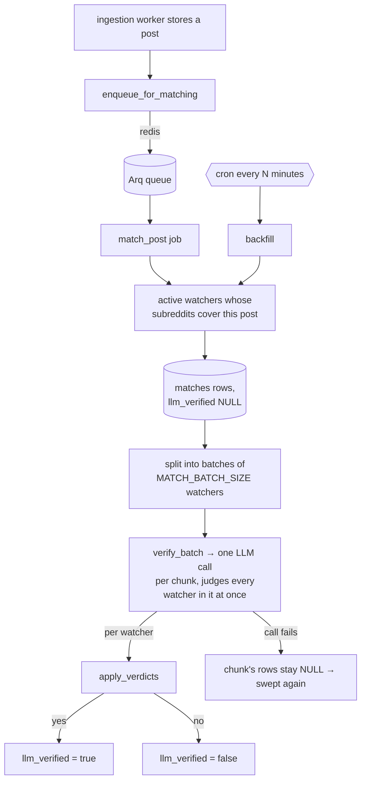

# Matcher

Code-level walkthrough of the matching pipeline stage. Companion to [[ARCHITECTURE]] §3 (design
intent). This document describes what the code *currently does*.

**What it does, in one sentence**: for each new post, find every active watcher subscribed to
its subreddit, and ask an LLM for a yes/no verdict on all of them at once.

It does not notify anyone — that worker doesn't exist yet. It runs as an Arq consumer
(`arq app.workers.match.WorkerSettings`), and in docker-compose it is the `worker-match` service.

## 1. Files involved

| File | Purpose |
|---|---|
| [`backend/app/workers/match.py`](../../backend/app/workers/match.py) | The worker — finding candidates, the batched verify step, the backfill sweep, and the Arq configuration. |
| [`backend/app/workers/verifier.py`](../../backend/app/workers/verifier.py) | Everything that talks to the LLM: the batched prompt, the structured-output schema, and the reply parser. |
| [`backend/app/models/match.py`](../../backend/app/models/match.py) | The `matches` table — one row per (watcher, post) pair considered, verdict included. |
| [`backend/app/models/watcher.py`](../../backend/app/models/watcher.py) | `intent_text` is the matcher's only input from the watcher — there is no stored embedding or direction field to keep in sync. |
| [`backend/app/workers/ingest.py`](../../backend/app/workers/ingest.py) | Enqueues a `match_post` job the moment a post is inserted. |
| [`backend/alembic/versions/f6b1e4a92c73_remove_embedding_and_direction_columns.py`](../../backend/alembic/versions/f6b1e4a92c73_remove_embedding_and_direction_columns.py) | Removes the vector/direction columns this design no longer needs. |
| [`backend/tests/test_match.py`](../../backend/tests/test_match.py), [`test_verifier.py`](../../backend/tests/test_verifier.py) | Coverage across the two modules. |

## 2. Flow at a glance



## 3. Why one LLM call per post, not one per candidate

An earlier design computed embeddings for posts and watcher intents, ranked candidates by cosine
similarity, and verified only the top-K with a separate LLM call per candidate. Measured on real
r/forhire data, raw similarity against the intent *"someone looking to hire a developer"* put six
offer posts above every request — embeddings encode topic, not which side of a transaction a post
is on, and a bolted-on "direction axis" fix was needed to compensate.

The current design drops the vector stage entirely. Every active watcher subscribed to a post's
subreddit goes straight into **one batched LLM call per post** (chunked only if a subreddit has
more candidates than `MATCH_BATCH_SIZE`), and the model judges direction fresh from `intent_text`
and the post's actual content on every call — no stored label, no embedding, no separate axis.
Batching by post rather than by (post, watcher) pair is deliberate on two counts: it turns
"cost scales with posts × watchers-per-subreddit" into "cost scales with posts", and it puts every
subscribed watcher's intent in front of the model in the same context, so a "someone hiring a
developer" watcher and a "developer for hire" watcher are judged side by side instead of each in
isolation — the isolation is exactly what let the old vector stage rank them backwards.

## 4. Step by step

### 4.1 Finding candidates — `fetch_candidate_watchers()`

```python
select(Watcher).where(
    Watcher.status == "active",
    Watcher.subreddits.any(subreddit),
)
```

Two filters: paused watchers are ignored, and the subreddit filter runs in SQL so only genuinely
subscribed watchers are ever sent to the LLM.

### 4.2 Placeholder rows — `store_placeholder_matches()`

Before any LLM call happens, one `INSERT ... ON CONFLICT DO NOTHING` writes a `(watcher_id,
reddit_post_id)` row per candidate, `llm_verified` left NULL. This is what lets a job that dies
mid-batch — process killed, network drop — leave a clean trail: `ix_matches_pending_verification`
(unchanged from the earlier schema) already knows how to find these rows, and the backfill sweep
retries them without any new indexing work.

### 4.3 Batching — `chunk_watchers()`

Splits the candidate list into groups of `MATCH_BATCH_SIZE` (default 15). Most subreddits have far
fewer active watchers than that, so in practice this is usually one chunk — the split exists to
bound prompt size and the blast radius of one failed call, not because batching is normally
needed.

### 4.4 Verifying — `verify_batch()` in `verifier.py`

One call per chunk. The prompt lists the post once, then every candidate watcher's intent,
numbered. The model returns structured JSON (OpenAI `response_format: json_schema`, strict mode)
with one verdict per candidate number — numbers are used instead of asking the model to echo a
UUID, because a small integer is far less likely to come back mistyped, and `apply_candidate_numbers()`
maps the reply back onto real `watcher_id`s in code.

The system prompt requires **three** things per candidate, all of which must hold:

1. **Direction** — is the poster on the side this watcher cares about (requesting vs. offering),
   or does the watcher not care (a plain topic watch)? Explicitly instructed to judge from what
   the poster is doing, *not* from tags or title formatting, because posters mislabel their own
   posts.
2. **Subject** — is it the specific kind of work or topic described? Same direction but a
   different field is not a match.
3. **Substance** — a real instance of the thing, not a meta post, survey, or job-board digest.

Ties go to `false`. A refusal (`message.refusal` on the OpenAI response) is treated as a call
failure, not a rejection — the row stays NULL rather than recording a verdict the model never
actually gave.

### 4.5 Applying verdicts — `apply_verdicts()`

One query loads every still-`NULL` match row for the post among the verdicted `watcher_id`s, then
writes `llm_verified`/`llm_reason`/`llm_model`/`verified_at` and commits once for the whole chunk.
A verdict for a row that is missing or already judged is silently skipped, so re-running a chunk
is idempotent.

### 4.6 The sweep — `backfill()`

Two passes, in order: unjudged candidates first (already-placeholder rows waiting on a verdict —
paid-for work, in the sense that the placeholder insert already happened), then posts with **no**
`matches` row at all, meaning no `match_post` job ever ran for them (enqueue failure, or a job
that exhausted its retries). The second pass re-derives candidates from scratch via
`fetch_candidate_watchers`, so a watcher created after a post's original ingest still picks it up.

## 5. Schema

`matches` keeps `llm_verified` (nullable — NULL = not yet judged, `false` = judged and rejected,
`true` = confirmed), `llm_reason`, `llm_model`, and the notification/read timestamps. Migration
`f6b1e4a92c73` drops `similarity`, `direction_score`, and `adjusted_score` (nothing computes them
anymore) along with `watchers.direction` and every embedding column on `watchers`/`reddit_posts`.

`ix_matches_pending_verification` (`WHERE llm_verified IS NULL`) is unchanged from the earlier
schema and does the same job here: it's the backfill sweep's index into unjudged placeholder rows.

## 6. Configuration

| Setting | Default | Effect |
|---|---|---|
| `OPENAI_API_KEY` | empty | **Required.** The worker refuses to start without it. |
| `VERIFIER_MODEL` | `gpt-4o-mini` | Explicit choice for this pipeline — see the model comparison discussion that preceded this build. |
| `MATCH_BATCH_SIZE` | `15` | Watchers per LLM call. A subreddit with more active watchers than this is split into several calls. |
| `MATCH_BACKFILL_INTERVAL_MINUTES` | `5` | Sweep frequency. Should divide 60 evenly. |
| `MATCH_BACKFILL_LIMIT` | `200` | Max rows per sweep, per stage. Bounds worst-case spend per pass. |

## 7. Testing

`FakeVerifier` lives in [`tests/conftest.py`](../../backend/tests/conftest.py), satisfying the
`IntentVerifier` protocol's `verify_batch()` method with no key and no network — same reasoning as
before: the protocol exists so tests exercise the real `match.py` code paths rather than mocking
them out. DB-touching functions (`fetch_candidate_watchers`, `store_placeholder_matches`,
`apply_verdicts`, `match_post`, `backfill`) run against a real, rolled-back Postgres, same
convention as `test_watchers_api.py`/`test_matches_api.py` — the actual `ON CONFLICT`/`IN (...)`/
`NOT EXISTS` queries are what need checking, not a hand-rolled session fake.

## 8. Known gaps

- **No notification.** Confirmed matches sit in `matches` with `notified_at` NULL. That worker is
  the next milestone.
- **No heartbeat.** Log lines only, same gap as the other workers.
- **RSS mode weakens the verifier's input.** Titles only means less for the model to read. Do not
  judge verdict quality on RSS-derived data.
- **Cost logging is per-call, not aggregated.**
- **`MATCH_BATCH_SIZE` is a starting guess, not a tuned value** — nothing has measured whether
  batching many watchers into one call degrades verdict quality as the batch grows. Watch the
  `matches.llm_reason` log for signs of the model losing track of a candidate in a large batch.
