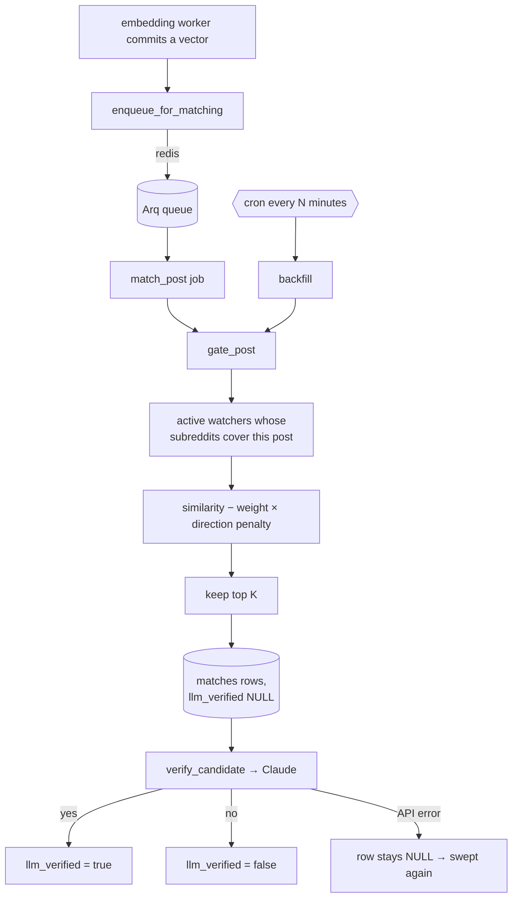

# Matcher + LLM Verifier

Code-level walkthrough of the third pipeline stage. Companion to [[ARCHITECTURE]] §3 (design intent)
and [[PROGRESS]] (what is built vs. pending). This document describes what the code *currently does*
— where it diverges from the architecture doc, that is called out explicitly.

**What it does, in one sentence**: for each newly embedded post, pick the handful of watchers it
might satisfy, then ask Claude whether it actually does.

It does not notify anyone — that worker doesn't exist yet. It runs as an Arq consumer
(`arq app.workers.match.WorkerSettings`), and in docker-compose it is the `worker-match` service.

## 1. Files involved

| File | Purpose |
|---|---|
| [`backend/app/workers/match.py`](../../backend/app/workers/match.py) | The worker — the vector gate, the verify step, the backfill sweep, and the Arq configuration. |
| [`backend/app/workers/direction.py`](../../backend/app/workers/direction.py) | The request/offer direction axis and its scoring helpers. |
| [`backend/app/workers/verifier.py`](../../backend/app/workers/verifier.py) | Everything that talks to Claude, plus the prompt and the reply parser. |
| [`backend/app/models/match.py`](../../backend/app/models/match.py) | The `matches` table — one row per candidate considered, verdict included. |
| [`backend/app/models/watcher.py`](../../backend/app/models/watcher.py) | Gained `direction`. The matcher's most important input after the embedding. |
| [`backend/app/workers/embed.py`](../../backend/app/workers/embed.py) | Now enqueues a `match_post` job after each post's vector is committed. |
| [`backend/alembic/versions/c3f8a1b56e42_add_matches_and_watcher_direction.py`](../../backend/alembic/versions/c3f8a1b56e42_add_matches_and_watcher_direction.py) | Creates `matches` and adds `watchers.direction`. |
| [`backend/tests/test_match.py`](../../backend/tests/test_match.py), [`test_direction.py`](../../backend/tests/test_direction.py), [`test_verifier.py`](../../backend/tests/test_verifier.py) | 60 tests across the three modules. |

## 2. Flow at a glance



## 3. Why two stages

The vector stage cannot carry precision. Measured on the 25 real r/forhire posts
([[PROGRESS]], 2026-07-30), raw cosine similarity against the intent *"someone looking to hire a
developer"* put **six offer posts above every request**, all at a confident-looking 0.51–0.63 —
and none of the five requests in that sample was hiring a developer either, so the correct answer
was zero matches. Acting on similarity alone would have produced 100% false positives.

So the split is: the vector stage decides *what is worth asking about*, and Claude decides *the
answer*. Their error costs are asymmetric and that drives every tuning decision here — a false
positive at the gate costs one cheap LLM call, while a false negative is silent, unrecoverable, and
invisible in any metric.

## 4. Step by step

### 4.1 Startup — `startup()` (`match.py:238-259`)

Arq calls this once per process. It builds the verifier, then computes the direction axis — one
embedding call — and stores both in the job context. The embedding provider is closed immediately
afterwards; the matcher never embeds anything else.

The axis is deterministic for a fixed phrase list and model, so scores stay comparable across
restarts. Both keys are required: `build_verifier` and `build_embedding_provider` each raise at
startup with a message naming the file to put the key in.

### 4.2 The direction axis — `direction.py`

The root cause of the needs-vs-offers failure is that embeddings encode *topic*, not the direction
of a transaction. "Someone looking to hire a developer" and "[FOR HIRE] Full Stack Developer" share
nearly all their topical content; who is asking versus who is offering is a small pragmatic signal
that gets compressed away.

The axis isolates exactly that one signal:

```
d = normalise( mean(OFFER_PHRASINGS) − mean(REQUEST_PHRASINGS) )
```

The phrasings are **deliberately topic-free** — no job title, skill, industry, or price. That is
the whole design, not an incidental detail, and a test asserts it. An earlier candidate approach
built a bespoke per-watcher "anti-example" vector; it separated direction better on average but
**suppressed a real match** whose wording happened to resemble the anti-example (a true ad-work post
fell from rank 1 to rank 11). For a recall-favouring gate that is disqualifying, so the topic-free
global axis won. Full comparison in [[PROGRESS]], 2026-07-30.

`direction_score(post, d)` projects a post onto the axis: positive reads like an offer, negative
like a request. On real data it lands around ±0.1 — a nudge to similarity, not a replacement.
Observed on the seeded r/forhire set, every `[Hiring]` post scored negative (−0.098 to −0.036) and
the `[FOR HIRE]` posts mostly positive, with no topic leakage.

`direction_penalty(score, watcher_direction)` is **one-sided**: a post pointing the wrong way for
this watcher is pushed down, and a post pointing the right way gets no bonus. Rewarding the right
direction would let a strongly-worded but topically irrelevant post outrank a well-matched one —
the mirror of the bug being fixed.

### 4.3 Finding candidates — `fetch_candidate_watchers()` (`match.py:53-63`)

```python
select(Watcher).where(
    Watcher.status == "active",
    Watcher.intent_embedding.is_not(None),
    Watcher.subreddits.any(subreddit),
)
```

Three filters, each load-bearing: paused watchers are ignored, un-embedded watchers cannot be
scored, and the subreddit filter runs in SQL so the vector maths only ever touches a small set.

### 4.4 Ranking — `rank_watchers()` (`match.py:72-92`)

```
adjusted = cosine(watcher.intent_embedding, post.embedding) − weight × direction_penalty(...)
```

Sorted descending, truncated to `MATCH_TOP_K`.

**An important subtlety about what the penalty can and cannot do.** The matcher ranks *watchers for
one post* — the opposite direction from the experiment that motivated the axis, which ranked posts
for one watcher. A post's direction score is a single number, so among watchers that all want the
same side it is a **constant offset and cannot reorder them**. Its two real jobs are:

- **Separating watchers that want opposite sides.** One post, two watchers, one after requests and
  one after offers: the penalty correctly puts the right one on top. This is where it reranks.
- **Pushing a whole candidate set down.** A wrong-direction post scores lower for every watcher
  that wants the other side, which is what makes an absolute floor meaningful once one exists.

Tests assert both behaviours, including the negative case — that same-direction watchers are *not*
reordered — so the limitation is pinned rather than assumed.

### 4.5 Writing candidates — `store_candidates()` (`match.py:96-124`)

One `INSERT ... ON CONFLICT DO NOTHING` against the `uq_matches_pair` unique constraint, with
`.returning(Match.id)` so only genuinely new rows come back. Re-running the gate over a post is
therefore idempotent and never re-verifies an old candidate — verified live, not assumed.

**Every candidate is written, pass or fail.** The rejected rows are the point: `similarity`,
`direction_score`, `adjusted_score`, and the verdict together are the labelled dataset that
eventually calibrates `MATCH_TOP_K` from real traffic. That data is cheap to collect now and
impossible to reconstruct later.

### 4.6 Verifying — `verify_candidate()` (`match.py:160-197`) and `verifier.py`

Loads the row, skips it if a verdict already exists (so duplicate delivery is a cheap no-op), and
asks Claude one yes/no question.

The system prompt requires **three** things, all of which must hold:

1. **Direction** — is the poster on the side the user cares about? Explicitly instructed to judge
   from what the poster is doing, *not* from tags or title formatting, because posters mislabel
   their own posts.
2. **Subject** — is it the specific kind of work described? Someone hiring a marketer does not
   match a user watching for people hiring developers. This is the check that would have rejected
   all 25 posts in the measured sample.
3. **Substance** — a real instance, not a meta post, survey, or job-board digest.

Ties go to `false`, with the reasoning stated in the prompt: a missed match costs one opportunity,
a false match costs trust in every future alert.

Two failure paths are handled deliberately:

- **`stop_reason == "refusal"`** raises rather than recording a rejection. A safety refusal is not
  a "no", and storing it as one would fabricate a verdict the model never gave.
- **An unparseable `matches` value** raises. `bool("false")` is `True` in Python, so a quoted
  `"false"` would otherwise be recorded as a match — `_coerce_bool` handles the string case
  explicitly and rejects anything it cannot read.

Either way the row stays `NULL` and the sweep retries it.

### 4.7 The sweep — `backfill()` (`match.py:224-248`)

Verifies unjudged candidates first, then gates posts that have never been through it. Unjudged
candidates come first because they are already-paid-for work waiting on a verdict.

`fetch_ungated_posts` uses `NOT EXISTS` rather than a join. A consequence worth knowing: a post in
a subreddit **nobody watches** produces no candidate rows, so it is re-checked on every sweep. That
is cheap and also correct — a watcher added tomorrow should pick it up.

## 5. Schema

Migration `c3f8a1b56e42` adds `watchers.direction` (`requesting` by default) and the `matches`
table. Four columns carry the calibration data — `similarity`, `direction_score`, `adjusted_score`,
and `llm_reason` — alongside the verdict itself.

`llm_verified` is **nullable on purpose** and has three meanings: `NULL` = not yet judged,
`false` = judged and rejected, `true` = confirmed. Collapsing NULL and false would destroy both the
retry mechanism and the labelled dataset.

Two partial indexes serve the two queues: `ix_matches_pending_verification` on
`WHERE llm_verified IS NULL`, and `ix_matches_pending_notification` on
`WHERE llm_verified IS TRUE AND notified_at IS NULL` — the latter for a worker that doesn't exist
yet, but the index costs nothing now and documents the intended hand-off.

`notified_at` and `read_at` are likewise present and unwritten, reserved for the notification worker
and the dashboard.

## 6. Configuration

| Setting | Default | Effect |
|---|---|---|
| `ANTHROPIC_API_KEY` | empty | **Required.** The worker refuses to start without it. |
| `OPENAI_API_KEY` | empty | **Also required** — the direction axis is computed at startup. |
| `VERIFIER_MODEL` | `claude-haiku-4-5` | Per [[ARCHITECTURE]] §5. Runs on every candidate, so cost per call is the constraint. |
| `MATCH_TOP_K` | `10` | Candidates per post. Bounds LLM spend per post directly. |
| `MATCH_DIRECTION_WEIGHT` | `1.0` | How hard to penalise a wrong-direction post. `0.0` disables the axis entirely. |
| `MATCH_BACKFILL_INTERVAL_MINUTES` | `5` | Sweep frequency. Should divide 60 evenly. |
| `MATCH_BACKFILL_LIMIT` | `200` | Max rows per sweep, per stage. Bounds worst-case spend per pass. |

`MATCH_TOP_K` defaults to 10 rather than 5 because on the only real data measured so far, **K=5
would have contained zero true matches** — the requests ranked 7th and 9th. It is a deliberately
loose starting point to be tuned from logged data, not a tuned value.

## 7. Testing

`FakeVerifier` lives in [`tests/conftest.py`](../../backend/tests/conftest.py) alongside
`FakeEmbeddingProvider`, satisfying the `IntentVerifier` protocol with no key and no network. Same
reasoning as the embedding worker: the protocol exists so tests exercise the real `match.py` code
paths rather than mocking them out.

Coverage includes the direction penalty's one-sidedness, the topic-free phrasing assertion, cosine
edge cases, top-K truncation, opposite-direction watcher separation, the negative case that
same-direction watchers are not reordered, verdict recording for both true and false, API failure
leaving rows `NULL`, already-judged rows being skipped, quoted-boolean parsing, prompt construction
and truncation, and the enqueue-after-commit ordering in the embedding worker.

## 8. Known gaps vs. the architecture doc

- **No similarity floor.** The gate is top-K only, so every post in a watched subreddit costs at
  least one LLM call — total spend scales as `posts × min(matching watchers, K)`. [[ARCHITECTURE]]
  allows either a loose cutoff *or* top-K; a floor is deliberately **not** invented here, because
  picking a number without data is exactly what that section says not to do. The `matches` log is
  what will set it.
- **No notification.** Confirmed matches sit in `matches` with `notified_at` NULL. That worker is
  the next milestone.
- **No heartbeat.** Same gap as the other two workers — log lines only ([[ARCHITECTURE]] §7).
- **Nothing sets `direction` per watcher.** The column exists and defaults to `requesting`;
  exposing it belongs to the watcher CRUD milestone.
- **RSS mode weakens both stages.** Titles only means weaker vectors *and* less for the verifier to
  read. Do not calibrate `MATCH_TOP_K` on RSS-derived data.
- **Verifier model is unvalidated.** `claude-haiku-4-5` follows the locked architecture decision,
  but no measurement supports it over a larger model yet. The logged verdicts are what will settle
  it.
- **Cost logging is per-call, not aggregated.** Same gap as the embedding worker.
