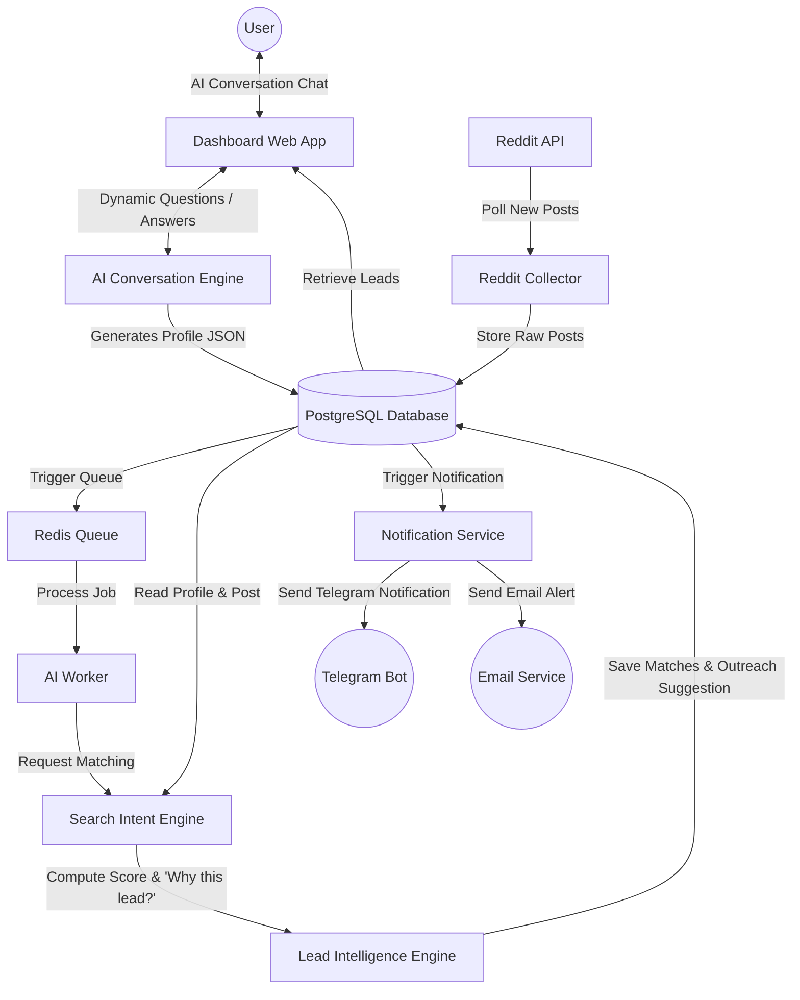

# LeadRadar AI - Product Requirements Document (PRD)

## Product Overview

LeadRadar AI is an AI-powered Lead Intelligence Platform that continuously monitors Reddit and identifies high-intent opportunities for freelancers and small agencies.

Unlike traditional keyword monitoring tools, LeadRadar AI's core differentiator is AI-powered Intent Discovery. It understands intent, business problems, urgency, and buying signals to surface qualified leads and generate suggested responses.

Preferences configuration is performed entirely through a natural AI conversation on the dashboard or in the settings page, meaning users are never required to manually configure keywords, services, industries, budgets, target audiences, or inclusion/exclusion filters.

Initial target users:

* Freelance developers
* Small software agencies
* Flutter developers
* Laravel developers
* AI consultants
* Automation consultants

Version 1 focuses exclusively on Reddit.

---

# Problem Statement

Current tools such as F5Bot rely on exact keyword matching.

Problems:

* **High Noise & Irrelevant Alerts:** Keyword tools trigger on any mention, yielding homework, tutorials, jobs, or unrelated queries.
* **Manual Configuration Overhead:** Users must configure and maintain complex lists of include/exclude keywords, budget settings, and target audiences.
* **No Contextual Understanding:** Lack of analysis regarding business problems, buyer authority, or actual buying intent.
* **No Prioritization:** Leads are sent chronologically without qualification scores or intent insights.
* **No CRM or Workflow Integration:** No tracking of communication status or lead progression.
* **No Assisted Outreach:** Users must write responses from scratch for every alert.

Users spend hours filtering out noise and manually searching, yet still miss high-value opportunities.

LeadRadar AI solves this by acting as an AI-powered Lead Intelligence Platform that replaces keyword monitoring with dynamic, conversational intent discovery and deep lead analysis.

---

# Core Differentiator

LeadRadar AI is NOT a keyword monitoring tool. The core differentiator is **AI-powered Intent Discovery**.

Instead of requiring users to manually configure keywords, services, industries, budgets, target audiences, or inclusion/exclusion filters, LeadRadar AI discovers these preferences through an interactive AI onboarding conversation. The platform then translates this conversation into an internal representation of search intent and evaluates opportunities based on semantic relevance, problem alignment, and buying signals.

---

# Product Vision

Transform Reddit conversations into qualified leads through AI-powered Lead Intelligence.

Instead of:

Keyword Configuration → Raw Alert Email

LeadRadar AI provides:

AI Chat Onboarding → Dynamic Search Intent Profile → AI Lead Discovery & Understanding → Explainable Match Reasoning → Dynamic CRM → Response Generation

---

# Target Users

## Freelancer

Needs:

* Find projects quickly
* Reply before competitors
* Avoid wasting time on low-quality posts and keyword noise

Success Metric:

* More client conversations

---

## Small Agency

Needs:

* Consistent lead flow
* Team visibility
* Lead tracking

Success Metric:

* More qualified opportunities

---

# MVP Scope

Data Sources:

* Reddit only

Onboarding Experience:

* Interactive AI Setup Chat (accessible from the Dashboard or Settings; max 6 questions, dynamic follow-up, confidence threshold matching, and support for resets/updates)

Notifications:

* Telegram
* Email

Authentication:

* Email/password
* Google OAuth

AI Features:

* Search Intent Profile generation
* Lead scoring and explanation ("Why this lead?")
* Lead summaries
* Suggested replies

CRM:

* New
* Replied
* Interested
* Won
* Lost

---

# Search Intent Setup & Settings

LeadRadar AI replaces the complex, multi-field onboarding forms of traditional tools with a conversational **AI Chat Setup** that occurs after landing on the dashboard.

1. **Dashboard Entry:** When a new user logs in or signs up, they land directly on the Dashboard. If they have not configured their search preferences, they are prompted to start the setup conversation.
2. **Settings Integration:** This conversation flow is hosted in Settings, allowing users to start, reset, or update their Search Intent Profile at any time.
3. **The Core Question:** The setup conversation begins with a single, simple prompt:
   > "What kinds of opportunities would you like me to notify you about?"
4. **Natural Input:** The user describes their business, target clients, and goals in natural language.
   * *Example:* "I help small businesses automate manual processes and build custom web applications. I want to find startups and business owners looking for automation, internal tools, SaaS MVPs, or custom websites. Ignore job posts, homework, and tutorials."
5. **Dynamic Evaluation:** The AI analyzes the input. If it has sufficient context (Confidence $\ge 90\%$), setup completes immediately.
6. **Targeted Follow-Ups:** If details are missing, the AI asks exactly **one follow-up question at a time**, dynamically generating the question to address the most critical missing context.
   * *Examples:*
     * "What type of clients do you usually enjoy working with?"
     * "Should I notify you only when people explicitly ask for developers, or also when businesses describe problems you could solve?"
     * "Are there any conversations you never want to see?"
7. **Termination & Profile Generation:** The setup flow ends once the AI achieves $\ge 90\%$ confidence in the user's intent or when the maximum limit of **6 questions** is reached. It then generates the internal Search Intent Profile.

---

# AI Conversation Engine

## Purpose
The AI Conversation Engine drives the preferences setup and settings configuration. It is designed to extract a user’s target opportunities, business capabilities, and preferences through a natural chat interface rather than complex forms, drop-downs, or keyword input fields.

## Responsibilities
* Conduct a natural language conversation to discover the user's business.
* Dynamically generate follow-up questions based on the user's previous answers.
* Assess the completeness and confidence level of the gathered information after each turn.
* Convert the unstructured conversation history into a structured Search Intent Profile.
* Prevent over-questioning by asking only the most critical missing piece of information at each step.

## Conversation Flow
1. **Initial Hook:** The engine starts the conversation with the open-ended question:
   > "What kinds of opportunities would you like me to notify you about?"
2. **User Input:** The user provides a free-form text response (e.g., describing services, target clients, exclusions).
3. **Information Extraction & Confidence Assessment:** The engine parses the user response, maps extracted details to the internal Search Intent Profile, and computes a confidence score (from 0.0 to 1.0).
4. **Dynamic Follow-Up:**
   * If confidence is $< 90\%$ and the question count is $< 6$, the AI identifies the most critical missing attribute (e.g., target business type, excluded types, services) and asks **exactly one** dynamic follow-up question.
   * If confidence $\ge 90\%$ or the max question limit of 6 is reached, the conversation terminates.
5. **Finalization:** The AI builds the final Search Intent Profile and activates active monitoring.

## Stopping Conditions
* **Confidence Metric:** The internal confidence score reaches or exceeds 90% (0.90).
* **Question Limit:** The AI has asked a maximum of 6 onboarding questions.
* **Sufficient Context:** Even if confidence is slightly below 90%, the AI terminates if it has enough information to construct an accurate initial profile, avoiding user fatigue.

## Confidence Scoring
The confidence score is dynamically calculated based on:
* **Attribute Completeness:** The ratio of populated critical fields (e.g., services, desired opportunities, target businesses) to empty ones.
* **Specificity Score:** Evaluates the level of details within each field (e.g., "custom web applications" gets a higher specificity weight than just "software").
* **Negation / Exclusions Check:** Whether the AI has clarified what the user *does not* want.

## Profile Generation
Upon completion, the engine runs a structured generation call to output the initial Search Intent Profile JSON. This JSON is saved internally and is never shown to or edited by the user.

---

# Search Intent Engine

## Purpose
The Search Intent Engine is responsible for matching incoming Reddit posts against the user's Search Intent Profile. It replaces traditional SQL or regex keyword matching with semantic and contextual analysis.

## Internal Representation
The user's preferences are stored in the database as an internal **Search Intent Profile** JSON object:
```json
{
  "services": ["business automation", "custom web applications", "SaaS MVPs", "internal tools"],
  "desired_opportunities": ["startups looking for automation", "business owners needing custom software", "MVP builds"],
  "target_businesses": ["startups", "small business owners"],
  "preferred_industries": [],
  "excluded_opportunities": ["job posts", "homework", "tutorials", "salary-based employment"],
  "buying_intent_preferences": {
    "require_budget_mention": false,
    "allow_implied_needs": true
  },
  "confidence": 0.94
}
```

## How Reddit Posts are Matched
When a Reddit post is collected:
1. The post's title, body, author, subreddit, and metadata are extracted.
2. The Search Intent Engine processes the post along with the user's Search Intent Profile.
3. The engine performs:
   * **Semantic Similarity Analysis:** Compares the post's core request to the profile's `desired_opportunities` and `services`.
   * **Exclusion Filtering:** Checks if the post contains elements matching `excluded_opportunities` (e.g., tutorial queries, academic homework, or standard corporate job postings).
   * **Buying Intent Detection:** Analyzes the post for signals of budget, urgency, decision-making authority, or explicit/implicit call-for-help.

## Confidence Calculation
The engine calculates a match confidence score representing how strongly the post aligns with the user's profile. Factors include:
* **Problem-Solution Alignment:** How well the problem described in the post matches the services/opportunities in the profile.
* **Authority Signal:** Whether the poster is a founder, business owner, or decision-maker.
* **Negative Signal Penalties:** Deductions for ambiguous language, tutorial requests, or indicators of low budget.

## Match Reasoning & Explainability
To build trust, the engine generates structured match reasoning. For every matched lead, the engine provides a "Why this lead?" breakdown:
* **Matched Opportunity:** The specific service or opportunity from the profile that matched.
* **Persona Match:** Detected poster type (e.g., "Startup founder detected").
* **Intent Strength:** Evaluation of the buying signal (e.g., "Strong buying intent").
* **Feedback Similarity:** If applicable, similarity to past leads marked "Relevant" by the user.

Example output structure in the dashboard:
> **Why this lead?**
> * ✓ Matches your preferred opportunity: Business Automation
> * ✓ Startup founder detected
> * ✓ Strong buying intent
> * ✓ Similar to opportunities you've marked relevant
>
> **Estimated project value:** $5k-$10k

---

# Functional Requirements

## Reddit Monitoring

System continuously monitors selected subreddits.

Examples:
* `r/startups`
* `r/smallbusiness`
* `r/entrepreneur`
* `r/SaaS`
* `r/forhire`

System collects:
* Title
* Content
* Author
* Subreddit
* URL
* Timestamp

---

## Lead Intelligence Engine

Whenever a Reddit post is collected, the Lead Intelligence Engine qualifies it by comparing the post with the user's Search Intent Profile.

The engine determines:
1. **Relevance:** Is this post relevant to the user's services and target goals? (Yes/No)
2. **Match Reasoning:** Bulleted list of reasons explaining why this lead fits the profile.
3. **Confidence:** A confidence score of the match (0 to 100).
4. **Buying Intent:** Categorization of intent strength (Low, Medium, High).
5. **Estimated Project Value:** Projected range (e.g., "$1k-$3k", "$5k-$10k", etc.) based on scope signals in the post.
6. **Urgency:** Detected timeline signals (e.g., Immediate, High, Medium, Low).
7. **Recommended Service:** The service from the profile that best solves the poster's problem.

The Lead Intelligence Engine returns structured JSON for integration:

```json
{
  "relevant": true,
  "confidence": 0.95,
  "match_reasoning": [
    "Matches your preferred opportunity: Business Automation",
    "Startup founder detected",
    "Strong buying intent",
    "Similar to opportunities you've marked relevant"
  ],
  "buying_intent": "High",
  "estimated_project_value": "$5k-$10k",
  "urgency": "High",
  "recommended_service": "Business Automation"
}
```

---

## Lead Scoring

Scoring range: 0-100

Categories:
* 0-40 = Low
* 41-70 = Medium
* 71-100 = High

Scoring Factors:
* Buying intent signals
* Business owner/decision-maker presence
* Budget mentions or implications
* Project urgency
* Need for custom software, automation, or agency services

---

## AI Summary

Converts lengthy Reddit posts into a clear, 1-2 sentence business-focused summary.
* *Example:* Restaurant owner seeking website rebuild with online ordering functionality. Budget approximately $5,000. High buying intent.

---

## AI Reply Generator

Generates a context-aware outreach response tailored to the post context and user's profile services.
* *Example:* "Hi! I noticed you're looking to rebuild your restaurant website. I specialize in custom web applications and would be happy to discuss your requirements."

---

## Notifications

* **Trigger:** Score $\ge$ User Threshold
* **Channels:** Telegram Bot, Email
* **Content:** Notification includes lead score, summary, "Open Reddit" link, and "Copy Suggested Reply" actions.

---

## Lead Dashboard

The dashboard focuses on highlighting qualified opportunities, showing explainable intelligence rather than raw text.

### Key Views
* **Inbox / New Leads:** Newly discovered leads awaiting user action.
* **High Intent Leads:** Filtered list of leads with top scores and strong buying intent.
* **Pipeline / CRM Views:** Tracks leads by stage (Replied, Interested, Won, Lost).
* **Saved Leads:** Bookmarked leads for future action.

### Explainability in the Dashboard
For every matched lead in the dashboard, the system displays an explainability block detailing why it was selected.
* *Example Panel:*
  > ### Why this lead?
  > * ✓ Matches your preferred opportunity: **Business Automation**
  > * ✓ Startup founder detected
  > * ✓ Strong buying intent
  > * ✓ Similar to opportunities you've marked relevant
  >
  > **Estimated project value:** $5k-$10k

### Filters
* Match Confidence/Score
* Target Service Type
* Estimated Value
* Industry / Business Type
* Date Discovered

---

## Lead Details

Clicking any lead opens the Lead Details page, which is the primary work area for outreach.

### Displayed Information
1. **Reddit Post Context:** Full original title, body text, author, subreddit, and direct link to Reddit.
2. **AI Summary:** A concise 1-2 sentence business-focused summary of the post.
3. **Explainability & Qualifications (Why This Lead?):**
   * Detailed checklist of matching intent criteria from the Search Intent Profile.
   * Specific signals detected (e.g., budget mentions, urgency level, authority role).
4. **Project Financials & Urgency:**
   * Estimated Project Value (e.g., `$5k-$10k`).
   * Urgency (e.g., `High`).
   * Recommended Service (e.g., `Custom Web App`).
5. **AI Reply Generator:**
   * Context-aware drafted reply based on the post details and the user's services.
   * A "Copy Reply" and "Open Reddit to Reply" action.
6. **CRM Controls:**
   * Move lead stage (New → Replied → Interested → Won / Lost).
   * Internal notes log.
   * Follow-up scheduler.

---

## CRM Pipeline Stages

Leads transition through the following pipeline:
New → Replied → Interested → Won / Lost

CRM data stored:
* Conversation status
* Detailed notes logs
* Follow-up dates and reminders
* Custom tags

---

# System Architecture



---

# Tech Stack

## Frontend

Next.js 15

React

TypeScript

Tailwind CSS

shadcn/ui

TanStack Query

Zustand

---

## Backend

FastAPI

Python 3.13

Pydantic

SQLAlchemy

Alembic

---

## Database

PostgreSQL

---

## Queue

Redis

Celery

---

## AI

OpenRouter

Provider abstraction layer

Supported later:

* OpenAI
* Claude
* Gemini
* Local Models

---

## Authentication

JWT

Google OAuth

Refresh Tokens

---

## Notifications

Telegram Bot API

Resend Email

---

## Search

PostgreSQL Full Text Search

Upgrade later:

Meilisearch

---

## Monitoring

Sentry

Structured Logging

Health Checks

---

## Deployment

Docker

Docker Compose

Nginx

Hetzner VPS

---

# Database Tables

users

user_preferences

reddit_posts

lead_analysis

lead_status

notifications

reply_templates

saved_leads

subscriptions

---

# Search Intent Profile

Instead of requiring users to manually manage configurations, checkboxes, or keyword strings, user settings and criteria are stored in an internal **Search Intent Profile**. Users only interact with the platform through natural conversation; they never view or edit the JSON profile directly.

### Search Intent Profile JSON Structure
```json
{
  "services": ["business automation", "custom web applications", "SaaS MVPs", "internal tools"],
  "desired_opportunities": ["startups looking for automation", "business owners needing custom software", "MVP builds"],
  "target_businesses": ["startups", "small business owners"],
  "preferred_industries": [],
  "excluded_opportunities": ["job posts", "homework", "tutorials", "salary-based employment"],
  "buying_intent_preferences": {
    "require_budget_mention": false,
    "allow_implied_needs": true
  },
  "confidence": 0.94
}
```

* **services:** List of services the user offers.
* **desired_opportunities:** Specific project types and opportunities the user wants to identify.
* **target_businesses:** The ideal customer profile/personas.
* **preferred_industries:** Industries the user specializes in or prefers.
* **excluded_opportunities:** Keywords, phrases, or post types to ignore.
* **buying_intent_preferences:** Contextual rules for matching intent.
* **confidence:** The onboarding engine's confidence level in this profile.

---

# API Endpoints

POST /auth/login

POST /auth/register

GET /leads

GET /leads/{id}

PATCH /leads/{id}/status

GET /notifications

GET /analytics

POST /settings

POST /generate-reply

---

# Analytics

Metrics:

* Leads Found
* Leads Replied
* Leads Won
* Conversion Rate
* Average Lead Score
* Top Industries

---

# Pricing

## Free

20 leads/month

Email notifications

---

## Pro

Unlimited leads

Telegram

CRM

AI replies

---

## Agency

Multiple users

Shared pipeline

Advanced analytics

---

# Development Phases

Phase 1

Personal Tool

* Reddit collector
* AI scoring
* Telegram notifications

Phase 2

Private Beta

* Dashboard
* CRM
* Email notifications

Phase 3

Public SaaS

* Billing
* Teams
* Analytics

Phase 4

Expansion

* Hacker News
* Indie Hackers
* GitHub Discussions
* X

---

# Success Metrics

Personal Validation:

* Generate first lead

MVP Validation:

* 10 active users

Product Validation:

* First paying customer

Growth Validation:

* 100 paying users

---

# Future Roadmap & Learning System

## AI Learning System (Post-MVP)
To continually refine the platform's understanding of user preferences, LeadRadar AI will implement a continuous feedback loop:
* **Feedback Mechanism:** Users can mark matched leads directly in the interface with:
  * 👍 **Relevant** (Reinforces the current Search Intent Profile)
  * 👎 **Not Relevant** (Identifies false positives to update exclusions)
* **Adaptive Profile Tuning:** When feedback is submitted, the Search Intent Profile is updated:
  * Positive feedback extracts common topics, phrasing, and target business types to add to `desired_opportunities` or `services`.
  * Negative feedback adds negative signals, specific phrasing, and industries to `excluded_opportunities`.
* **Zero-Touch Onboarding:** Over time, onboarding conversations become almost unnecessary because the AI learns directly from user behavior and classification choices.

## Product Expansion Phases

### Phase 1: Personal Tool & Core Matching
* AI Conversation Engine and initial Search Intent Profile.
* Reddit collector.
* Search Intent Engine matching and explainable "Why this lead?" generation.
* Telegram notifications for high-intent matches.

### Phase 2: Private Beta & Dynamic Dashboard
* Full Web Dashboard and Lead Details interface.
* CRM status pipeline.
* Email notifications.
* Feedback mechanism (👍/👎) for profile tuning.

### Phase 3: Public SaaS & Scaling
* Stripe billing integration.
* Team accounts and shared CRM pipeline.
* Advanced analytics reporting.

### Phase 4: Platform Expansion
Integrate lead ingestion for:
* Hacker News
* Indie Hackers
* GitHub Discussions
* X (formerly Twitter)
* Freelance Job Boards (Upwork, RemoteOK)

---

# Long-Term Vision

Become the leading AI-powered Lead Intelligence Platform for freelancers, service agencies, and consultants.

Instead of setting up brittle keyword queries, users hire LeadRadar AI as their tireless research assistant. The assistant learns through lightweight onboarding and ongoing feedback, constantly discovering qualified opportunities, analyzing context, providing explainable matches, and facilitating frictionless client outreach.

